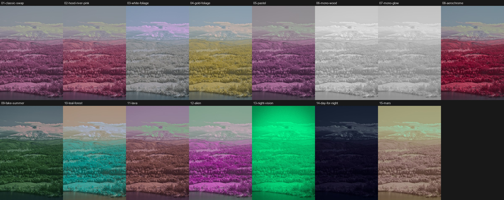
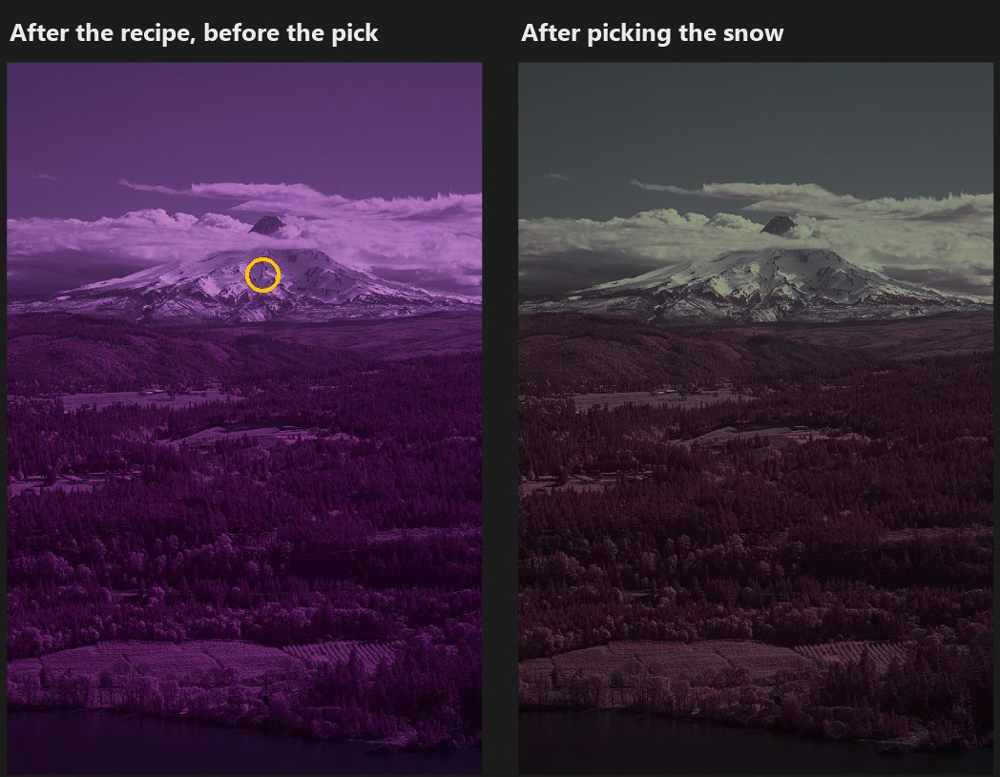

# LightCraft IR Presets

Fifteen infrared presets for [LightCraft](https://github.com/storytold/lightcraft), built on its RGB **Channel
Mixer**: classic red/blue swaps, a few wild false-colour looks, and some silly ones on purpose.

**Not official, not part of LightCraft.** The Channel Mixer these presets use is proposed in
[storytold/lightcraft#3579](https://github.com/storytold/lightcraft/pull/3579) and isn't in a LightCraft release yet.
Until it is, the presets need a build of that pull request (see [below](#which-lightcraft)). In a LightCraft
without the Channel Mixer they import, but only the white balance and tone settings apply, which gives a strong blue
cast.



## Install

**Requires a LightCraft with the Channel Mixer** ([PR #3579](https://github.com/storytold/lightcraft/pull/3579)):
the [IR playground](https://darthnut.github.io/lightcraft-ir-recipes/) or a build of the PR
([see below](#which-lightcraft)). A regular LightCraft release imports the presets but can't apply them.

1. Download from the [latest release](../../releases/latest):
   - **`IR Recipes.lcpreset`** (it downloads as `IR.Recipes.lcpreset`) for all fifteen presets in one file, or
   - one group: `ir-presets-classic.lcpreset`, `ir-presets-wild.lcpreset` or `ir-presets-silly.lcpreset`, or
   - just the ones you want: each preset is also its own file, named after it (`classic-swap.lcpreset`,
     `aerochrome.lcpreset`…).

   The [preset list](#the-presets) below links straight to each file, and they're all in the [`presets`](presets)
   folder here too.
2. In LightCraft, either drag the file(s) onto the window, or click **Import Presets…** at the top of the Presets
   panel (also under **File ▸ Import Presets…**).

They appear in three groups: **IR Recipes 1 · Classic**, **2 · Wild** and **3 · Silly**. A single preset goes into
its usual group too, and mixing is fine: a preset you already have is skipped, so importing everything after a few
single ones doesn't add duplicates.

### Updating to a new version

Importing doesn't replace presets you already have. A preset whose settings changed is added next to the old one
with the same name. So before importing a new version, **delete the three IR Recipes groups** (right-click a group in
the Presets panel), then import the new file.

## Using them

1. **Click a preset.** It sets the Channel Mixer and white balance, plus a few touches like Vibrance or Contrast.
2. **If the name says "(pick …)", pick.** In the **Channel Mixer** section, click the picker (the eyedropper):

   

   Then click what the name says:
   - **snow/cloud/concrete:** anything that should come out white or grey;
   - **foliage:** bright leafy trees or grass.

   

   Names ending in **(no pick)** need no step 2.
3. **Adjust Exposure to taste.** The picker keeps the spot's own brightness and never changes Exposure. If a strong
   mix has to be scaled down to fit the sliders, it says so ("Darker by 0.4…"): raise Exposure by about that much.
4. **Switching presets:** click the new preset, then pick again. A preset sets the mixer and white balance, which
   replaces your last pick.

**Presets replace each other cleanly.** Every preset sets the same settings: the mixer, white balance, and every
tone and colour setting any of the presets uses (Vibrance, Saturation, Contrast, Clarity, the tone curve, colour
grading, the HSL mixer, vignette and grain), at zero when it doesn't use one. So going from Day for Night or Night
Vision back to Classic Swap leaves no grading, vignette or grain behind, and clicking back and forth always gives the
same result. Settings no preset uses (sharpening, noise reduction, lens corrections, crop, masks) are left alone,
and so is **Exposure**: no preset ever changes it. The flip side: a preset replaces your own changes to those tone and
colour settings, so apply the preset first, then fine-tune.

Then open **Channel Mixer** to see how the look is made, and change it from there.

**Which filter?** The presets were fitted on a 590 nm camera. They're a reasonable start for 590–720 nm and
full-spectrum cameras with an IR filter. At **850 nm** and beyond there's almost no colour to mix, so use the two
**IR Mono** presets.

## The presets

Download a whole group in one file, or each preset on its own (⬇ in the last column). Or get all fifteen: [⬇ `IR.Recipes.lcpreset`](https://github.com/darthnut/lightcraft-ir-presets/releases/latest/download/IR.Recipes.lcpreset).

### IR Recipes 1 · Classic

Swaps and monochrome: the looks most IR photographers start from. All 7 in one file: [⬇ `ir-presets-classic.lcpreset`](https://github.com/darthnut/lightcraft-ir-presets/releases/latest/download/ir-presets-classic.lcpreset)

| Preset | Pick | Look | Download |
| --- | --- | --- | --- |
| Classic Swap | neutral | The textbook red/blue swap. On a 590 nm filter that gives pink foliage and a teal sky | [⬇](https://github.com/darthnut/lightcraft-ir-presets/releases/latest/download/classic-swap.lcpreset) |
| Mt Hood Pink | neutral | The colour settings of the Mt. Hood edit in the pull request | [⬇](https://github.com/darthnut/lightcraft-ir-presets/releases/latest/download/mt-hood-pink.lcpreset) |
| White Foliage, Blue Sky | foliage | White trees under a blue sky | [⬇](https://github.com/darthnut/lightcraft-ir-presets/releases/latest/download/white-foliage.lcpreset) |
| Gold Foliage, Blue Sky | neutral | Gold trees, the look many 590 nm tutorials show | [⬇](https://github.com/darthnut/lightcraft-ir-presets/releases/latest/download/gold-foliage.lcpreset) |
| Soft Pastel | neutral | Half swap, low contrast, a faint pink/teal split tone | [⬇](https://github.com/darthnut/lightcraft-ir-presets/releases/latest/download/pastel.lcpreset) |
| IR Mono, Wood Effect | none | Black and white from the red channel, punchy | [⬇](https://github.com/darthnut/lightcraft-ir-presets/releases/latest/download/mono-wood.lcpreset) |
| IR Mono, Soft Glow | none | Same source, negative Clarity for a dreamy glow | [⬇](https://github.com/darthnut/lightcraft-ir-presets/releases/latest/download/mono-glow.lcpreset) |

### IR Recipes 2 · Wild

False-colour looks that send foliage and sky to new hues. All 5 in one file: [⬇ `ir-presets-wild.lcpreset`](https://github.com/darthnut/lightcraft-ir-presets/releases/latest/download/ir-presets-wild.lcpreset)

| Preset | Pick | Look | Download |
| --- | --- | --- | --- |
| Faux Aerochrome | neutral | Red foliage in the style of Kodak Aerochrome film | [⬇](https://github.com/darthnut/lightcraft-ir-presets/releases/latest/download/aerochrome.lcpreset) |
| Fake Summer | neutral | Green trees again, though not quite the right green | [⬇](https://github.com/darthnut/lightcraft-ir-presets/releases/latest/download/fake-summer.lcpreset) |
| Teal Forest, Orange Sky | neutral | Complementary teal and orange | [⬇](https://github.com/darthnut/lightcraft-ir-presets/releases/latest/download/teal-forest.lcpreset) |
| Lava Fields | neutral | Brick-red land under a violet sky | [⬇](https://github.com/darthnut/lightcraft-ir-presets/releases/latest/download/lava.lcpreset) |
| Alien Planet | neutral | Magenta trees, a green-tinted sky | [⬇](https://github.com/darthnut/lightcraft-ir-presets/releases/latest/download/alien.lcpreset) |

### IR Recipes 3 · Silly

Silly on purpose. All 3 in one file: [⬇ `ir-presets-silly.lcpreset`](https://github.com/darthnut/lightcraft-ir-presets/releases/latest/download/ir-presets-silly.lcpreset)

| Preset | Pick | Look | Download |
| --- | --- | --- | --- |
| Night Vision Goggles | none | Green phosphor, vignette and grain; lower Exposure if it's too bright | [⬇](https://github.com/darthnut/lightcraft-ir-presets/releases/latest/download/night-vision.lcpreset) |
| Day for Night | neutral | Old-Hollywood fake moonlight: dark, blue, desaturated (darkened by the tone curve, not Exposure) | [⬇](https://github.com/darthnut/lightcraft-ir-presets/releases/latest/download/day-for-night.lcpreset) |
| Mars Holiday | foliage | Everything rust and dust | [⬇](https://github.com/darthnut/lightcraft-ir-presets/releases/latest/download/mars.lcpreset) |

("neutral" means pick snow, cloud or concrete.)

**White balance jumps to 2000 K:** the picked presets set it on purpose. A 590 nm raw is so red that some mixers black
out the spot before the picker can measure it, and it refuses. The pick cancels white balance anyway, so this doesn't
change the colours.

## Which LightCraft?

The presets need the Channel Mixer from
[storytold/lightcraft#3579](https://github.com/storytold/lightcraft/pull/3579). Until it's merged:

- **In your browser:** the [IR playground](https://darthnut.github.io/lightcraft-ir-recipes/) is a test build with the
  mixer and these presets already built in. Nothing to install.
- **On the desktop:** build the pull request's branch (you need [Rust](https://rustup.rs)):

  ```bash
  git clone --branch feat/channel-mixer https://github.com/darthnut/lightcraft.git lightcraft-mixer
  ```

  ```bash
  cd lightcraft-mixer
  ```

  ```bash
  cargo run --release -p lightcraft -- --library ~/lightcraft-mixer-test
  ```

  The `--library` folder keeps this test build away from your real LightCraft library.

## How they were made

- **Fitted to one photo.** The colours of snow, foliage and sky were measured in one raw from a Sony A6000 with a
  590 nm filter, each "wild" mixer was solved to send those colours to a target hue, and the result was checked by
  rendering it. Other filters, sensors and subjects will land differently.
- **Always pickable.** In every picked preset, each mixer row adds up to 100 %, which guarantees the picker can solve
  it, whatever the camera.

`make_recipes.py` generates `IR Recipes.lcpreset` and every file in `presets`: edit the numbers there, never a
`.lcpreset` by hand, then run

```bash
python make_recipes.py
```

A check on every push makes sure the committed files match what the script generates.

## Share yours

Got IR numbers from Photoshop, GIMP, Affinity, Capture One or another editor's channel mixer?
[Share them with this form](../../issues/new?template=share-recipe.yml). Good ones may become presets here, credited.

Made by darthnut with Claude (Anthropic). Licensed MIT or Apache-2.0, like LightCraft. The sample photos are by
darthnut, shared under [CC BY-NC 4.0](https://creativecommons.org/licenses/by-nc/4.0/): free to use and adapt with
credit, not for commercial use.
